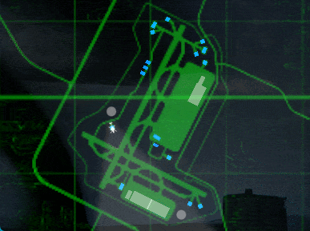

# Map Mouse Select (& more)

WIP quality of life mod for Nuclear Option: drag a box on a map to select units in bulk, better target designation in flight, plus some fixes and small conveniences around the map and the target list. Name pending.



## Changes

Many of those things have configurations if you have BepInEx config manager installed. I have not thoroughly checked but from a glance they seem alright and I got positive feedback of them already

### Added

- Marquee: drag a box on the map to select in bulk, in both map modes:
  - plain marquee replaces the selection (blue by default).
  - `Shift` adds to selection (green by default).
  - `Ctrl` removes from selection (red by default).
- New keys, all rebindable/resettable as vanilla ones:
  - `\` selects/keeps only the unit you are pointing at
  - `-` drops the unit you are pointing at
  - `Delete` drops your oldest target, hold it to keep only the newest
  - `Ctrl+E` leaves an aircraft safely (only when parked on the ground at one of your own airbases)
- Wrecks: a destroyed but repairable building keeps its map icon, darkened, instead of vanishing. They stay unselectable (unless in commander mode where this does nothing) and they can't be targeted still.
- Two buttons in the Target List pane:
  - `NTL` for toggling neutrals on the map;
  - `DED` for repairable wrecks.
- Optional joystick mode for the pan button: hold it, push the cursor away from where you pressed, and the map scrolls at a speed that grows with the push (`MapStick`, off by default, requires map pan fix to be enabled).
- The cursor changes to move cursor while you pan the map.
- Optional frame rate cap while the game is not focused (off for hosts and doesn't allow going to framerates which slow down the world by default).

### Changed from vanilla

- A plain click on the map in flight replaces the target list instead of adding to it.
- A drag ending on empty map now clears the selection.
- Panning moved to the middle mouse button, camera jump to a double left click on the map.
- With the map open, bindings sitting on a bare Shift or Ctrl are held off, so the marquee modifiers do not fire them too.

### Vanilla bugs fixed

- Shift+click on a selected unit properly deselects it.
- A selected unit's icon stays clickable, so its tooltip and the Shift-click deselect work again.
- Filter dimming is no longer lost after a deselect.
- Target List rows no longer outlive the selection (unselect all, respawn, spawn screen).
- The mouse wheel no longer moves the camera's field of view behind menus, or in the flyby view while the map is open.
- Dragging the map moves it exactly as far as the mouse, instead of further the slower the game runs and in bursts (`MapPanSpeed` scales it).

## Download and install

Needs BepInEx 5 x64 in the game directory.

1. Take the archive from the [latest release](https://github.com/Metadorius/MapMouseSelect/releases/latest), or [build it](#build) yourself.
2. Unzip it and put the `MapMouseSelect` folder into `Nuclear Option\BepInEx\plugins\`.
3. Start the game. The mod writes its config to `BepInEx\config\com.kerbiter.mapmouseselect.cfg`.

The archive holds the DLL, the readme and the licence. NOMM entry pending, so for now the folder goes in by hand as above.

Every setting is documented in that file and in the Configuration Manager window (F1) while the game runs. [The full list](docs/configuration.md).

Why each of these behaves the way it does, and what vanilla does in the same place, is in the [technical notes](docs/technical-notes.md#controls).

## Build

```powershell
dotnet build src\MapMouseSelect\MapMouseSelect.csproj -p:NuclearOptionRoot="D:\path\to\Nuclear Option"
```

The build resolves the game path from `-p:NuclearOptionRoot` first, then `Directory.Build.user.props`, then the `NUCLEAR_OPTION_ROOT` variable, and stops with an explanation rather than guessing. It copies the DLL into the game unless you pass `-p:DeployToPlugins=false`. Copy `Directory.Build.user.props.example` to get started. The rest, including the launch config and how to tell which build the game loaded, is in the [technical notes](docs/technical-notes.md#build-and-launch).

## Disclaimers

### AI usage

This mod is authored by an experienced software engineer, but by vibecoding as an experiment. Treat it as pre-release, because the code has only been partially reviewed manually (but is tested to the extent of my imagination). It is published in the hope that it is useful, but as is and without warranties.

### Client-side mod and fair play considerations

Most of this is a client mod, and I understand that any quality of life change can be read as a slight advantage online. I think a client mod is fair here, because it takes away friction where the friction did not look intended (and does not a lot of it), and fixes some bugs (and also reassigns the control schema by default). Nearly everything it does was already possible with a bit more clicking/alternate means: mass selection was spamming Enter on the map while moving the mouse, keeping only a new target was deselect all followed by a select (and you generally mass select your targets before a bombing run rather than in the middle of one, at least for me, so there's not much skill element reduction at play).

I really hope such improvements will appear in vanilla. However, if there are stronger reservations against such, I am open to constructive discussion.

## Licence

GPL-3.0. See [LICENSE](LICENSE). Copyright (C) 2026 Metadorius.

GPL-3.0 wants the source to travel with the binary, and this repository is that source for every release.

